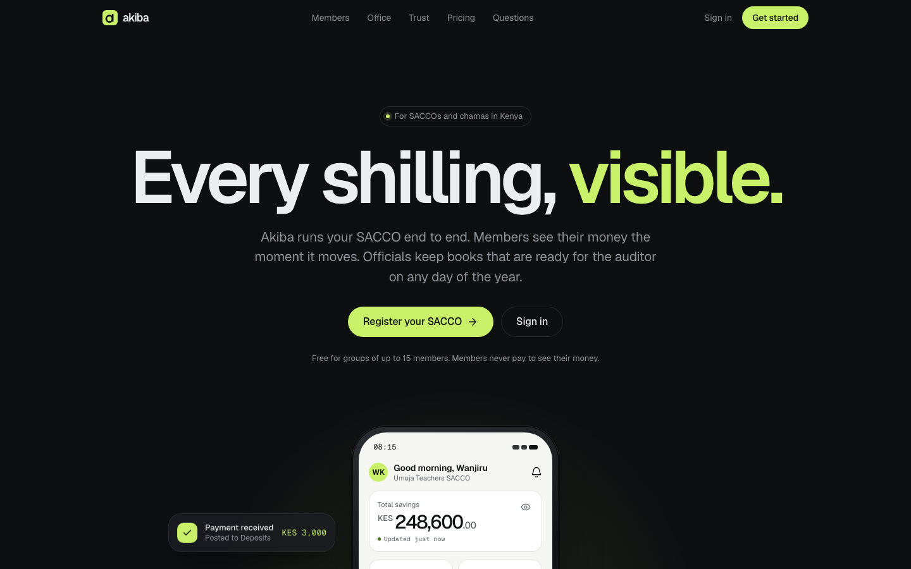

# Akiba

**Every shilling, visible. A SACCO operating system for Kenyan SACCOs and chamas.**

[**▶ Live demo**](https://akiba-sacco.vercel.app) · [More of my work](https://github.com/Legitimacy426) · [Hire me](mailto:fondoadam@f8ware.com)

## What it does

A multi-tenant, trust-first SACCO platform: a member app for iOS, Android and web plus a back office for officials, all from one Expo codebase. Members see their money the moment it moves; officials keep books that are ready for the auditor any day of the year.

## Highlights

- Multi-tenant: one platform, many SACCOs
- Member app on iOS, Android and web from one codebase
- Savings, loans, statements and payments
- Office tools for officials, audit-ready books

## Built with

Expo · React Native · Convex · Better Auth · Tailwind (Uniwind) · Resend

## Source code

This is a showcase repository. The source is private because it is a commercial product.
I'm happy to walk through the architecture and code on a call. [Get in touch](mailto:fondoadam@f8ware.com).

---

Built by **[Fondo Adam](https://github.com/Legitimacy426)**: full-stack web & mobile engineer in Kenya. [Portfolio](https://fondoadam.f8ware.com)
